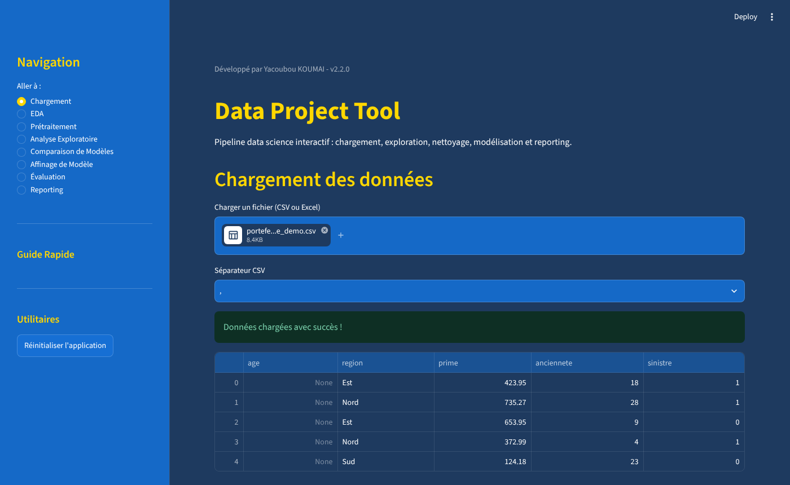
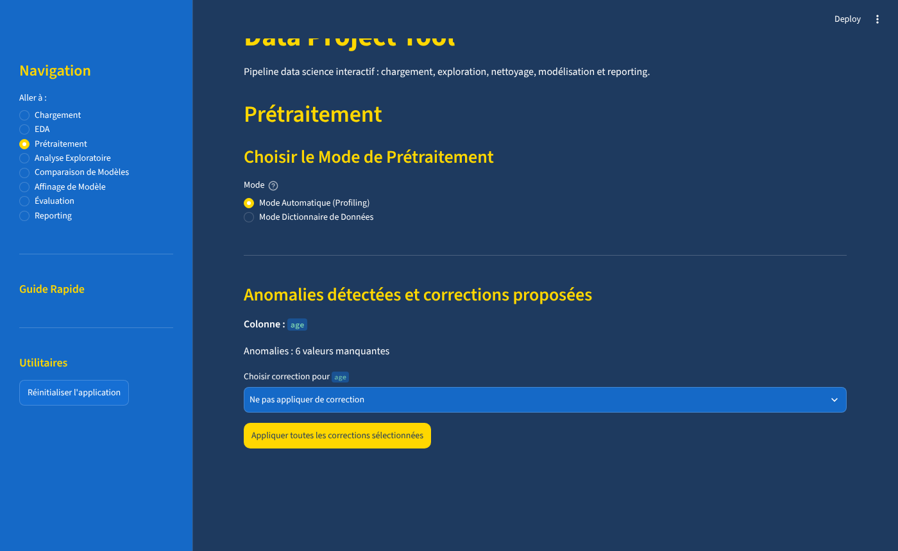
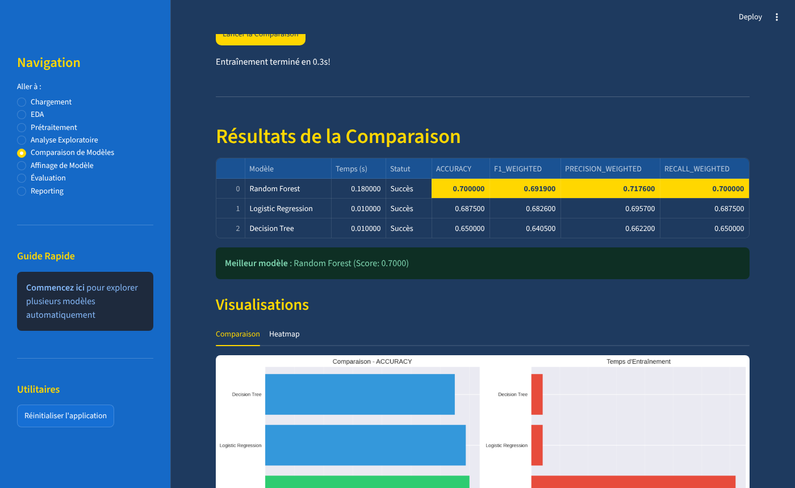

# Data Project Tool

Application Streamlit qui couvre un projet data science de bout en bout, sans écrire
de code : chargement d'un fichier, exploration, nettoyage, modélisation, évaluation
et rapport HTML.

Application en ligne : https://datatool-koumai.streamlit.app/

## Aperçu

| Chargement | Prétraitement | Comparaison de modèles |
|---|---|---|
|  |  |  |

## Fonctionnalités

| Section | Contenu |
|---|---|
| Chargement | Fichiers CSV (séparateur au choix) et Excel (choix de la feuille) |
| EDA | Aperçu, statistiques descriptives, rapport ydata-profiling (affichage et téléchargement), histogrammes, matrice de corrélation (Pearson, Spearman, Kendall) |
| Prétraitement | Mode automatique : anomalies détectées par le profiling (valeurs manquantes, colonnes constantes, cardinalité élevée, valeurs infinies, doublons) et corrections au choix, avec journal téléchargeable. Mode dictionnaire : contrôle des données selon des règles métier (voir plus bas) |
| Analyse exploratoire | Analyses bivariées (quali/quali, quali/quanti, quanti/quanti), indicateurs actuariels, détection d'outliers, corrélations |
| Comparaison de modèles | Entraînement de plusieurs modèles en une fois, validation croisée optionnelle, mode rapide pour les gros fichiers, tableau, graphiques, export CSV et téléchargement du meilleur modèle |
| Affinage de modèle | Réglage des hyperparamètres d'un algorithme, pré-rempli avec le meilleur modèle de la comparaison ; téléchargement du modèle et des jeux d'entraînement et de test |
| Évaluation | Classification : matrice de confusion, courbes ROC et précision-rappel. Régression : résidus, valeurs prédites contre observées. Évaluation avancée : SHAP, déciles, courbes d'apprentissage, calibration |
| Reporting | Rapport HTML consolidé, sections au choix, téléchargeable |

Modèles disponibles :

- Classification : Random Forest, Gradient Boosting, Logistic Regression, Decision Tree, AdaBoost, Extra Trees, K-Nearest Neighbors, SVM, Naive Bayes.
- Régression : Random Forest, Gradient Boosting, Linear Regression, Ridge, Lasso, Decision Tree, AdaBoost, Extra Trees, K-Nearest Neighbors, SVR.

Le prétraitement des variables est automatique : imputation, standardisation optionnelle,
one-hot encoding, et Target Encoding pour les variables catégorielles de plus de 100 modalités.

## Prétraitement par dictionnaire de données

Le dictionnaire est un fichier CSV ou Excel avec une ligne par colonne à contrôler :

| Colonne | Contenu |
|---|---|
| `Colonne` | Nom de la colonne dans les données |
| `Type` | `numerique`, `categorique`, `texte` ou `date` |
| `Obligatoire` | `oui` ou `non` |
| `Valeurs_Autorisées` | Liste séparée par des virgules (catégorielles) |
| `Min`, `Max` | Bornes (numériques) |
| `Format` | Format attendu : `email`, expression régulière ou format de date |
| `Action_Si_Anomalie` | `imputer_moyenne`, `imputer_mediane`, `imputer_mode`, `supprimer_ligne`, `mettre_vide` ou `ignorer` |

Exemple : [`docs/dictionnaire_exemple.csv`](docs/dictionnaire_exemple.csv).

## Structure

```
data_tool_app.py            Point d'entrée Streamlit : navigation et sections
datatool/
    data_loader.py          Lecture CSV / Excel
    eda.py                  EDA rapide et rapport ydata-profiling
    preprocessing.py        Détection d'anomalies et corrections
    data_quality.py         Contrôles par dictionnaire de données
    exploratory_analysis.py Analyse exploratoire avancée
    model_utils.py          Fonctions communes de modélisation
    model_comparison.py     Comparaison de modèles
    modeling.py             Affinage d'un modèle
    metrics.py              Métriques
    evaluation.py           Évaluation du modèle
    advanced_evaluation.py  SHAP, déciles, apprentissage, calibration
    reporting.py            Rapport HTML
    validators.py           Validations avant chaque section
    error_handler.py        Gestion des erreurs par section
    assets/style.css        Thème visuel
.streamlit/config.toml      Thème (couleurs vérifiées pour la lisibilité) et limite de taille des fichiers (1,1 Go)
docs/                       Exemple de dictionnaire de données, captures d'écran
```

## Installation locale

Python 3.11 recommandé.

```bash
python -m venv .venv
source .venv/bin/activate        # Windows : .venv\Scripts\activate
pip install -r requirements.txt
streamlit run data_tool_app.py
```

## Notes techniques

- `setuptools` est limité à `<81` : ydata-profiling importe encore `pkg_resources`,
  retiré des versions récentes de setuptools.
- Aucun fichier n'est écrit sur le serveur : modèles, jeux de données et rapports sont
  servis en téléchargement, et chaque utilisateur garde ses résultats dans sa session.
- Les fichiers de plus de 10 000 lignes sont échantillonnés pour le profiling.

## Auteur

Yacoubou KOUMAI
